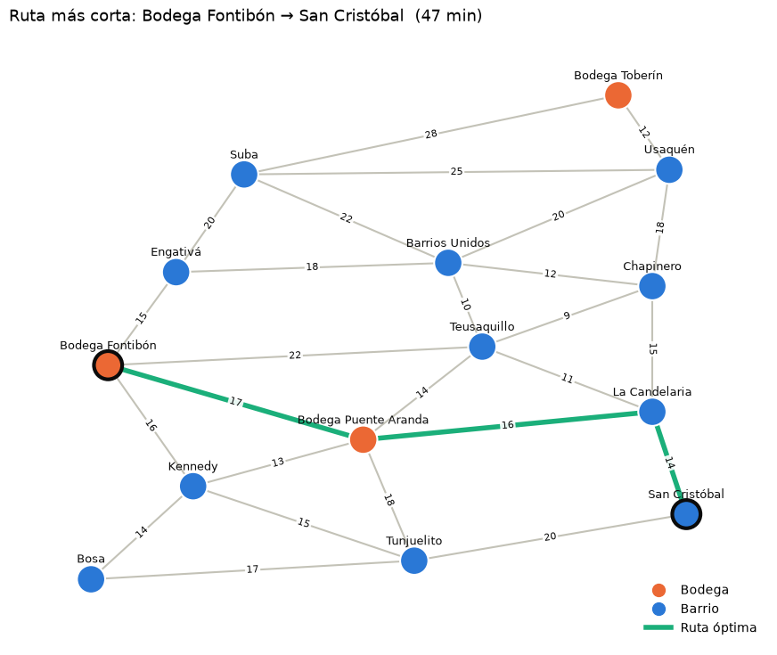
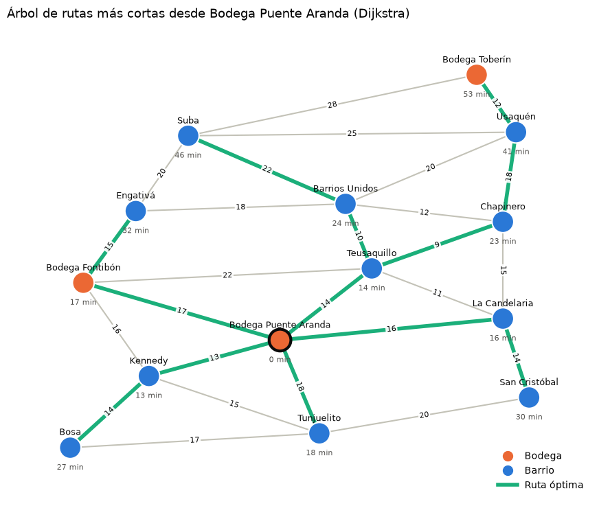
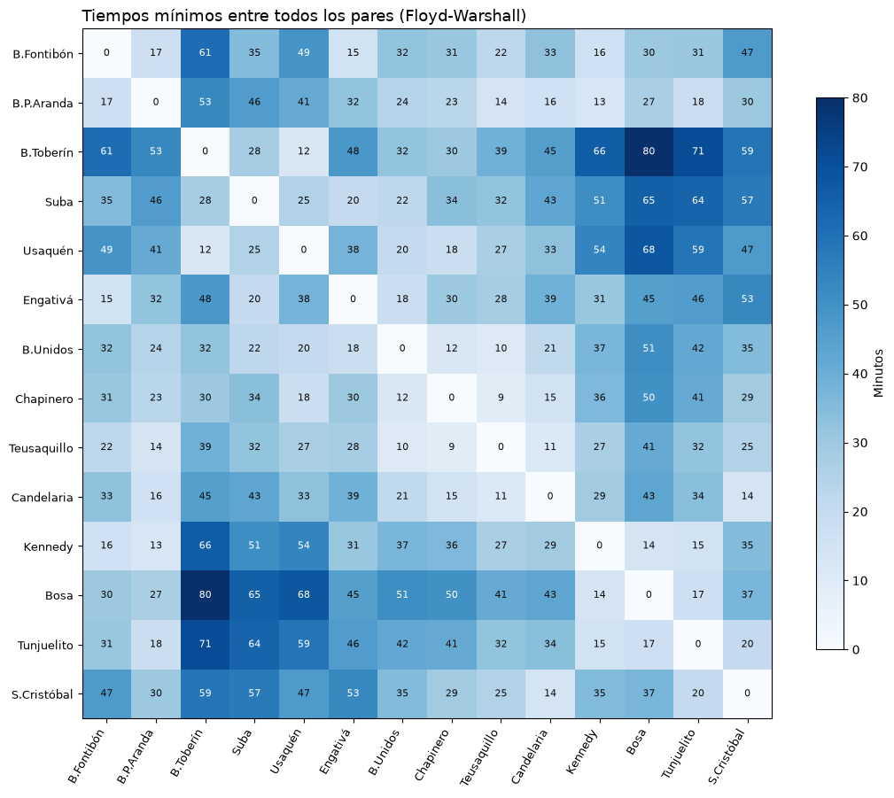

# LogiExpress — Rutas de entrega con grafos

[](https://colab.research.google.com/github/SamuelMarino2108/logiexpress-rutas/blob/main/LogiExpress.ipynb)

Sistema que calcula y recomienda las rutas de entrega más rápidas para una empresa de paquetería en
Bogotá. La red logística se modela como un **grafo ponderado**: las bodegas y los barrios son los vértices,
las vías son las aristas y su peso es el tiempo en minutos.

> Proyecto final de **Estructuras de Datos** — Ingeniería de Sistemas, Universidad EAN.



## Qué hace

- **Ruta más corta entre dos puntos** con Dijkstra, mostrando el detalle tramo a tramo.
- **Todas las rutas desde una bodega** con un solo Dijkstra, que forma el árbol de rutas más cortas.
- **Tiempos entre todos los pares** de ubicaciones con Floyd-Warshall, con mapa de calor.
- **Recomendación de bodega de despacho** para un pedido, consultando la matriz ya calculada.
- **Verificación cruzada**: Dijkstra desde cada origen da la misma matriz que Floyd-Warshall (196 pares).
- **Manejo de errores**: ubicaciones inexistentes, pesos negativos y destinos sin ruta.
- **Menú interactivo** por consola.

Los algoritmos están implementados desde cero. `networkx` se usa **solo para dibujar** el grafo.

## Estructuras y algoritmos

| Componente | Implementación | Complejidad |
|---|---|---|
| Grafo | Lista de adyacencia con diccionarios | O(V + E) memoria |
| Dijkstra | Cola de prioridad (`heapq`) + predecesores | O((V + E) log V) |
| Floyd-Warshall | Programación dinámica + matriz `siguiente` | O(V³) tiempo, O(V²) memoria |
| Recomendar bodega | Consulta sobre la matriz de Floyd-Warshall | O(B) |

La red de ejemplo tiene 3 bodegas (Fontibón, Puente Aranda, Toberín) y 11 barrios y localidades de Bogotá,
con tiempos aproximados en hora valle.

## Capturas

| Árbol de rutas desde Bodega Puente Aranda | Matriz de tiempos (Floyd-Warshall) |
|---|---|
|  |  |

## Cómo ejecutarlo

**En el navegador:** abre el notebook con el botón de Colab de arriba y ejecuta las celdas en orden.

**En local** (Python 3.10 o superior):

```bash
git clone https://github.com/SamuelMarino2108/logiexpress-rutas.git
cd logiexpress-rutas
pip install -r requirements.txt
jupyter notebook LogiExpress.ipynb
```

La sección 8 tiene ejemplos listos para ejecutar. La última celda abre el menú interactivo; escribe `0` para salir.

## Tecnologías

Python · `heapq` · Matplotlib · NetworkX (solo visualización) · Jupyter

## Autor

**Samuel Mariño** — [GitHub](https://github.com/SamuelMarino2108) · [LinkedIn](https://www.linkedin.com/in/samuel-edgardo-marino-medina) · [Portafolio](https://samuelmarino2108.github.io/portafolio/)
